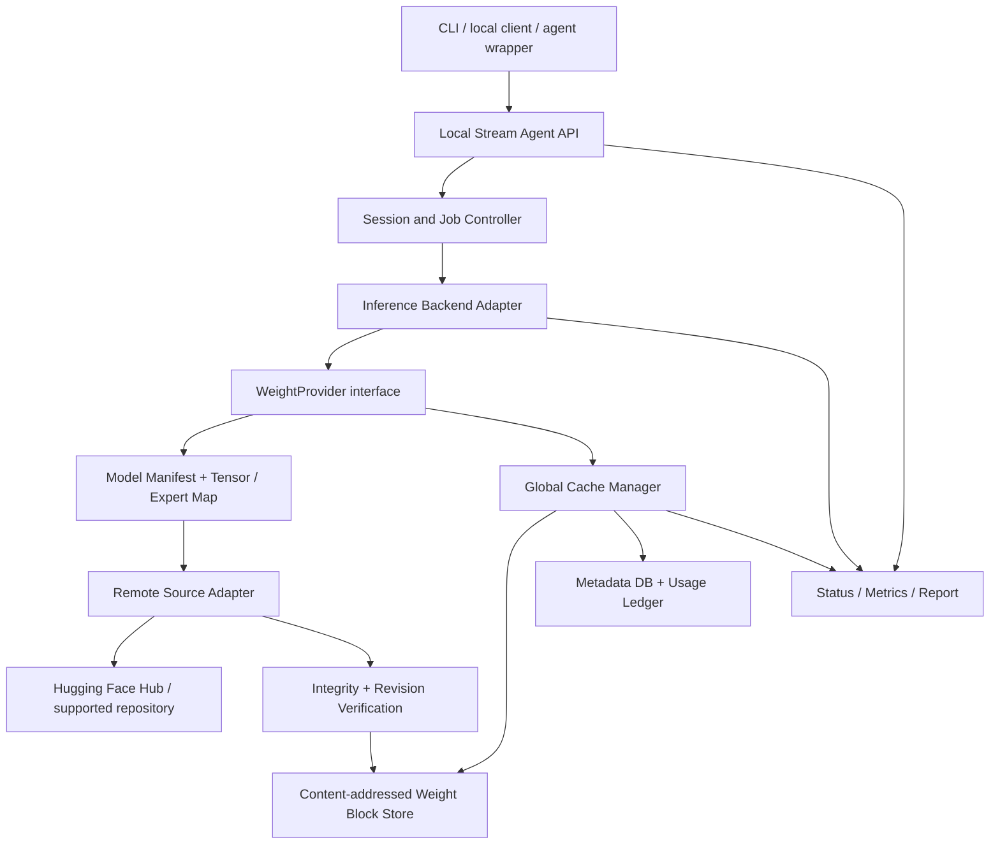

# Stream Agent — Storage-Budgeted On-Demand Model Runtime

**Document revision:** v0.1-design  
**Date:** 2026-10-21  
**Status:** Proposed specification; prototype, compatibility, and performance claims are not yet established  
**Project:** Yato-Works / Stream Agent  
**Owner:** Eli

> **One-line promise:** Let a user set an explicit local storage budget, then access compatible open-weight models through on-demand weight retrieval and a shared, bounded cache—without requiring every model's complete weight files to remain on the user's SSD.

> **Core example:** A machine has only about 20 GB available for managed model-weight cache. The user assigns approximate cache shares of 3 GB to Qwen3.8-27B, 10 GB to Kimi K3, and 7 GB to DeepSeek V4.1-Flash. These values describe *persistent cached weight data*, not model size, RAM/VRAM requirements, or a guarantee of usable speed. The runtime fetches required weight ranges as the selected backend asks for them, evicts eligible data under a defined policy, and records the traffic and latency this creates.

---

## 0. Scope boundary: this document is Stream Agent only

Stream Agent is a **storage-budgeted, remote-backed model-weight runtime and cache coordinator**. It is concerned with discovering a model revision, retrieving the exact weight data required by a supported inference backend, enforcing storage limits, and exposing a selected model to local applications or agent frameworks.

This is a separate project from **Pocket Harness**. It does not implement Pocket Harness's request/response repair proxy, context compression, tool selection, tool-call repair, loop guard, execution ledger, or coding-task completion benchmark. It may expose a local inference endpoint that an existing agent can call, but it does not attempt to make that agent's request history or tool behavior more reliable.

### In scope

- A user-defined hard budget for persistent model-weight cache.
- Per-model cache allocations or quotas within a global budget.
- Optional borrowing of unused quota under an explicit policy.
- On-demand remote retrieval of supported weight blocks/ranges from a model repository.
- Content identity, integrity validation, resumable fetching, bounded temporary storage, and cache eviction.
- Model-aware access to selected layers, tensors, or MoE experts **only where the chosen inference backend exposes those units safely**.
- A backend adapter boundary so model formats and inference engines can be evaluated independently.
- A local API/worker interface through which an agent can ask a selected model to perform a bounded task, including slow background reviews where appropriate.
- Instrumentation that reports storage use, network transfer, cache behavior, latency, and generated-token throughput.
- Per-model licensing, access, revision, and remote-code policy checks.

### Explicitly out of scope for v0.1

- Claiming that every model on Hugging Face or every open-weight model is supported.
- Making a model whose full weights exceed the cache budget behave as though it had been compressed into that budget.
- Guaranteeing interactive speed when most required weights must be downloaded repeatedly.
- Training, fine-tuning, or quantizing models as part of the core runtime.
- Building new CUDA/Metal/Vulkan kernels for every model architecture before the remote-cache path is proven.
- Becoming a full coding agent, replacing Cline/OpenCode/Claude Code, or implementing Pocket Harness features.
- Running arbitrary repository-supplied Python code by default.
- Hosting or re-distributing model weights from a central Stream Agent server.
- Automatically selecting paid cloud inference or silently switching to a different model/provider.
- Promising that model weights may be commercially used or re-distributed merely because they are downloadable.

## 1. Executive summary

Stream Agent explores a different resource constraint from the usual “does this model fit in VRAM?” question:

**How much persistent local storage does a user want to dedicate to model weights, and what inference capability can be delivered within that budget?**

The user chooses a total managed weight-cache budget, such as 20 GiB, and registers multiple model repositories. A cache policy governs which verified blocks remain on disk and which blocks must be fetched again. An inference backend requests named tensors, layer segments, or expert blocks through a `WeightProvider` interface. Stream Agent retrieves only the supported byte ranges, verifies their identity, makes them available to the backend, and evicts eligible cache entries without exceeding the configured limit.

The potential user value is straightforward: a user can experiment with or invoke models whose complete weight files do not fit in their available disk space, while trading storage for transfer volume, latency, and throughput explicitly. A slow model may still be useful as a background reviewer, planner, or “oracle” subagent when a fast local model handles ordinary work.

The hard part is not merely issuing HTTP range requests. The runtime must connect repository-level byte ranges to model-file layouts, connect those layouts to an inference engine that can consume partial weights, keep downloads and temporary buffers inside a strict storage budget, handle remote authentication and revision pinning, and avoid repeatedly downloading so much data that inference becomes impractical.

The product therefore follows a staged proof strategy:

1. Prove remote partial retrieval and byte integrity.
2. Prove a strictly bounded persistent cache with crash-safe eviction.
3. Connect one explicitly supported model format and backend end-to-end.
4. Measure the trade-off across cache sizes, network conditions, and cold/warm runs.
5. Add multiple models sharing a global storage budget.
6. Expose a stable local interface for background/subagent use.
7. Expand model-family support only when each adapter passes conformance and performance tests.

The first public claim should be based on this evidence—not on an assumption that all open models can already run under arbitrary cache limits.

## 2. Product goals and acceptance targets

All targets in this section are **proposed gates**, not achieved results. Initial measurements may show that some targets are too strict or that a use case is not viable. Such findings must be reported rather than hidden.

### 2.1 Primary goals

1. Keep persistent managed weight-cache data within a user-defined hard byte budget, including downloads in progress.
2. Retrieve only the supported file ranges needed by an enabled backend, without silently falling back to a complete model download.
3. Ensure every cached block is associated with an immutable model revision and validated identity.
4. Support more than one registered model under one global cache manager.
5. Expose enough data to understand whether a configuration is storage-efficient, bandwidth-heavy, or too slow for the intended use.
6. Make a selected streamed model usable as a local inference target; later, provide a bounded job/worker interface suitable for slow subagent tasks.
7. Keep model prompts and inference conversations local unless the user explicitly selects a remote inference provider. Downloading model weights from a repository does not mean sending prompts to that repository.
8. Preserve a clear boundary between the runtime, the inference backend, and any agent that invokes it.

### 2.2 Proposed v0.1 gates

| Gate | Proposed acceptance condition | Evidence required |
|---|---|---|
| G0 — Range integrity | A deterministic fixture suite retrieves requested file ranges and reconstructs their expected bytes correctly | Reference-file hashes, test ranges including boundaries, retry and corruption results |
| G1 — Storage limit | Managed weight payload never exceeds the configured hard limit, including in-flight temporary payloads reserved by the downloader | Instrumented usage, filesystem accounting, crash/restart and concurrent-download tests |
| G2 — No silent full download | A model add/serve attempt either uses the declared partial-access path or fails with a clear unsupported-capability reason | Network trace, disk-use trace, explicit unsupported-path test |
| G3 — One end-to-end model | At least one specifically named model revision can produce a response through a backend using the bounded remote-backed store | Reproduction script, exact commit/revision, backend version, model license, hardware and network profile |
| G4 — Multi-model accounting | At least two registered models share the same global store without violating global or per-model policy | Interleaved workload, eviction trace, quota report |
| G5 — Failure recovery | Interrupted retrieval can resume or safely restart; corrupted/incomplete blocks never become usable cache entries | Fault-injection tests and atomic-promotion checks |
| G6 — Agent invocation | One local client can invoke the selected model and receive a complete result or explicit job status | API conformance tests and a short local demo |

There is deliberately **no universal tokens/second target yet**. A speed promise is meaningful only after selecting a model format, an inference backend, a model revision, and a defined hardware/network profile. Set a workload-specific performance gate after G3 supplies real data.

### 2.3 Secondary goals for later releases

- Shared cache deduplication across identical content blocks.
- Cache reservation, soft quota, and “borrow unused capacity” policies.
- Predictive prefetching for known layer order and backend-supplied MoE routing hints.
- Explicit asynchronous job submission/polling for slow background tasks.
- An MCP adapter or other tool bridge for agent frameworks.
- Multiple download source adapters, beyond the first repository source.
- Optional local backend profiles for CPU, NVIDIA GPU, AMD GPU, Apple Silicon, or other devices, subject to real adapter work.

## 3. Terminology and guarantees

Clear terminology is essential because “the model runs in 3 GB” can mean several unrelated things.

| Term | Meaning in this specification |
|---|---|
| **Model size** | Total size of the selected weight artifact(s) at the pinned revision and chosen precision/quantization. |
| **Persistent weight-cache budget** | Maximum disk bytes occupied by retained downloaded weight blocks owned by the managed cache. |
| **Per-model quota** | A limit, reservation, or target governing how much of the shared cache a registered model may occupy. The selected policy must be explicit. |
| **Managed-store limit** | Optional stricter total limit covering weight blocks, partial downloads, indexes, databases, and runtime metadata. |
| **Working memory** | RAM/VRAM required for model execution, currently active tensors/experts, staging, activations, and the KV/recurrent state. This is separate from persistent cache. |
| **Remote-backed inference** | The backend can request weight data that is not currently resident in the local persistent cache. It does not imply that every model format can do so. |
| **Cache miss** | A requested, verified block is not available in the local weight store and must be fetched or reported unavailable. |
| **Cold run** | A run starting with none of the workload's required weight blocks retained in cache (subject to clearly recorded metadata warmness). |
| **Warm run** | A run after specified blocks have already been cached. The benchmark must report the actual starting state. |
| **SubAgent / worker** | A selected model invoked by another application to perform a bounded task. Stream Agent provides model execution access; it does not supply the parent agent's full planning/tool loop in v0.1. |
| **Open-weight** | Weights are available under some terms. It does not necessarily mean OSI-approved open source or unrestricted commercial redistribution. |

### 3.1 What a 3 GB cache does and does not mean

If a model has 70 GB of weights and its cache limit is 3 GB, the runtime is not converting 70 GB of weights into a 3 GB model. It is retaining at most the configured amount of downloaded weight payload locally and fetching absent data when needed.

A model may still require substantial RAM/VRAM for its current execution working set. If the largest indivisible unit that the backend must load exceeds available working memory, a disk-cache policy alone cannot make the model executable. Supporting sub-tensor slicing or paged kernels is a backend capability, not an automatic consequence of HTTP Range support.

The cumulative bytes downloaded during a long run may greatly exceed the cache size. Under cache thrashing, a dense model may repeatedly transfer much of its weight data for every generated token. Stream Agent must measure and display that cost rather than presenting cache size as a proxy for total network traffic.

## 4. Design principles

1. **Storage is a budget, not a compression claim.** Report cached bytes, full artifact size, cumulative downloaded bytes, and working-memory requirements separately.
2. **Hard limits are enforced before writes.** Reserve budget for in-flight downloads and temporary files before accepting a transfer. Do not finish a download and only then discover that the disk limit was exceeded.
3. **Only verified data is usable.** Partial, corrupt, stale, or revision-mismatched blocks cannot be promoted to READY.
4. **Pin immutable revisions.** `main` is a discovery alias, not a runtime identity. Resolve it once to a commit/revision and use that pinned revision for all file and weight requests in a run.
5. **Backends request semantic units.** Prefer requests such as `(tensor_id, slice)` or `(layer, expert_id)` over raw guessed offsets. The backend/format adapter is responsible for mapping those units to valid byte ranges.
6. **Cache decisions do not change weight values.** Cache placement, prefetch, eviction, and retry policies may change latency; they must not alter model tensor content.
7. **Fail closed on unsupported formats.** Do not fall back silently to full artifact downloads or execute arbitrary model repository code.
8. **No hidden cloud inference.** The core route retrieves model artifacts and performs inference locally. Any future remote inference provider must be a separate, explicit option.
9. **Report slow results honestly.** A model that technically produces one token after a very long stall is a successful bring-up test, not necessarily a usable agent backend.
10. **Prior art is real.** SSD-streaming and MoE expert-offload projects already exist. Stream Agent must differentiate through bounded remote-backed access, shared multi-model storage management, and integration ergonomics—not by claiming the basic streaming idea is new.

## 5. User stories and product contract

### 5.1 User stories

- “I have 20 GB available for model cache, not 1 TB. Let me choose which models get which part of it.”
- “I want to try a very large model without keeping every weight file permanently on my SSD.”
- “I accept that a slow model may run only as a background reviewer or planner. Show me the estimated and actual wait.”
- “I want to know whether a slow run was caused by network downloads, cache misses, disk I/O, inference compute, or a long prompt.”
- “I do not want a tool to exceed my disk budget or unexpectedly download the complete model.”
- “I want to pin the exact model revision, quantify what was downloaded, and reproduce a measurement.”
- “I may use gated models I personally have access to, without transferring my credentials to a third-party service.”

### 5.2 Product promise

Stream Agent promises **bounded local weight-cache storage and observability for supported remote-backed model/runtime combinations**.

It does not promise:

- that every open-weight model can be used immediately;
- that a model's complete memory footprint is limited to the cache budget;
- that a small cache yields high throughput;
- that a repository grants a user access or commercial rights;
- that a model's license allows Stream Agent to mirror or redistribute its weights;
- that a generic agent will correctly use a slow model without being configured for long latency or background jobs.

## 6. Architecture overview



### 6.1 Main data paths

**Cold data path**

1. User registers a model ID and immutable revision.
2. Catalog adapter fetches small metadata needed to identify files, configuration, tokenizer, shard indexes, and weight layout.
3. A supported backend opens a model session and asks for its first required weight units.
4. `WeightProvider` checks the local shared cache.
5. On a miss, the source adapter obtains the exact remote byte ranges/chunks needed, subject to auth and source protocol.
6. The budget manager reserves space, writes to bounded temporary storage, validates content, and atomically promotes completed blocks to the store.
7. The backend receives the verified data in the memory/layout expected by that engine.
8. Metrics record network, cache, disk, and inference timings.

**Warm data path**

1. The backend requests the same unit or an overlapping unit.
2. The cache manager looks up content by immutable artifact identity and range/block identity.
3. If present and verified, the block is read locally.
4. Usage metadata is updated without contacting the model repository unless a required refresh/check is configured.

**Multi-model path**

All registered models use one global budget manager. Each cache entry is owned/referenced by a model revision and charged according to the configured accounting policy. When the global budget is under pressure, Stream Agent evicts eligible entries based on the active policy, not by deleting arbitrary files outside the managed store.

## 7. Component specification

Each component should have a narrow interface and independent tests. Do not implement every model family inside the cache manager.

### C0 — CLI and configuration loader

Responsibilities:

- Validate model aliases, revisions, cache quotas, global budgets, source credentials, and backend identifiers.
- Resolve paths and present the real managed-store budget before download begins.
- Fail early when cache quotas exceed a hard global limit or when metadata/staging reserve has been omitted from a strict total-disk configuration.
- Never log tokens, signed URLs, or authorization headers.
- Print a clear capability report before starting a model session.

### C1 — Model Catalog / Revision Resolver

Responsibilities:

- Resolve a user-friendly repository ID plus ref (branch/tag/revision) to an immutable commit identity.
- Fetch file listings and lightweight metadata without downloading all weight shards.
- Record model repo, owner, commit, file names, exact file sizes, formats, declared license identifier, and access/gating status when available.
- Read the selected format's shard index and model config only through safe parsers.
- Treat model metadata as untrusted input: validate paths, sizes, offsets, shapes, and supported architecture declarations.
- Require re-resolution when the user changes revision; never combine weight blocks from different commits.

A license identifier fetched from model metadata is an indicator, not a legal conclusion. User review remains required.

### C2 — Remote Source Adapter

The first adapter target is Hugging Face Hub, but the interface must not bake Hugging Face details into cache or inference logic.

Responsibilities:

- Enumerate repository files and pinned revisions.
- Acquire the correct source protocol and token scope for the current repository/revision.
- Request a partial file range through the repository's supported download mechanism.
- Support bounded concurrency, connection reuse, timeouts, range validation, retry/backoff, cancellation, and resumable operations.
- Preserve a clear distinction between HTTP status, source authentication/authorization failure, model gating, missing revision, and provider outage.
- Verify response length and block/range identity before reporting success.
- Avoid any assumption that a plain HTTP `Range` header against an ordinary `resolve` URL will work for every Hub file.

For Xet-backed files, the published protocol is more than a single direct URL: it involves reconstruction metadata and fetching the required Xet ranges/chunks. The protocol documentation describes batched range queries for large files, short-lived signed URLs, range authorization, and the need to reassemble content according to the reconstruction response. Stream Agent should reuse supported Hub/Xet client libraries where they expose the required path; any lower-level implementation must have dedicated protocol tests and should not invent or cache signed URLs.

### C3 — Model Layout / Weight Map

Responsibilities:

- Map model concepts to byte ranges in a pinned artifact.
- Read supported `safetensors` headers and shard indexes, or supported GGUF metadata, without assuming one file equals one tensor/layer.
- Track exact file-global data offsets, tensor dtype/shape, shard name, and the adapter-defined slice layout.
- For tensors packed with multiple experts or substructures, permit slice requests only when the backend knows the tensor's byte layout and the dtype/quantization's alignment constraints.
- Reject unsupported architecture/layout combinations before starting a long remote stream.

The `safetensors` format stores a JSON header containing tensor shapes, dtypes, and data offsets. Sharded model repositories also use index metadata mapping tensor names to shard files. These structures make selective reads possible in principle, but they do not automatically make a standard inference backend capable of consuming arbitrary slices.

### C4 — WeightProvider / Block Reader

This is the boundary used by the inference backend. A request should use a stable semantic key and have a defined size.

Proposed abstract operations:

```python
class WeightProvider(Protocol):
    async def read_tensor(self, key: TensorKey) -> TensorBuffer: ...
    async def read_slice(self, key: TensorSliceKey) -> TensorBuffer: ...
    async def read_expert(self, key: ExpertKey) -> TensorBuffer: ...
    async def prefetch(self, keys: Sequence[WeightKey], priority: int) -> PrefetchHandle: ...
    async def cancel_prefetch(self, handle: PrefetchHandle) -> None: ...
```

The actual interface may vary by backend. Not every backend needs all operations; unsupported calls should raise a typed capability error.

Requirements:

- Align reads to the source protocol's actual valid transfer units and the tensor/quantization layout.
- Coalesce adjacent/overlapping ranges where that reduces network overhead without violating the cache budget.
- Keep in-memory staging buffers bounded and separate from the persistent disk-cache budget.
- Avoid blocking inference and download worker threads on unrelated cache database operations.
- Deduplicate concurrent requests for the same immutable block (“single-flight”) so multiple models/sessions do not trigger duplicate transfers.
- Permit cancellation only before a block is promoted; do not expose partially verified bytes.

### C5 — Global Cache Manager

This component enforces the central product contract.

#### Storage classes

The store distinguishes:

1. **Weight payload cache:** verified bytes that may be served to a backend.
2. **In-flight temporary payload:** fetched but not fully verified bytes, counted against capacity before writing.
3. **Metadata/index DB:** revision manifests, tensor maps, block ownership, access counters, and cache state.
4. **Logs/metrics:** local operational records.
5. **Runtime working memory:** RAM/VRAM buffers and model state, not disk cache.

The configuration must say whether the user's chosen value is a weight-payload budget or a strict entire-store disk cap. Never call the first a total disk cap.

#### Required invariants

- Global weight-payload bytes never exceed `weight_cache_limit_bytes` after reservation accounting.
- If `managed_store_limit_bytes` is configured, all managed persistent files and temporary payloads must remain within that larger hard limit, including metadata/log reserves.
- In-flight reservations are acquired before body data is written. If no capacity can be reserved, the transfer waits, evicts eligible entries, or fails explicitly.
- An entry in use cannot be removed while a backend still owns a lease/pin to it. The system must not deadlock if pinned entries fill the entire budget; it returns a clear “working set exceeds budget” error or applies a defined spill policy.
- Incomplete entries are never counted as valid hits.
- Cache state is reconstructible after a crash by scanning manifests and verifying block metadata; orphan partials are removed or resumed only when their identity is known.
- Two concurrent requests for the same block share an in-flight operation.
- All sizes are stored as integer bytes. UI formatting may show GB/GiB, but comparisons use bytes.

#### Cache entries

Each entry should record:

- content hash or validated source-protocol identity;
- repository ID and immutable commit;
- file path within the repository;
- file size and requested inclusive byte interval or canonical block key;
- expected and actual byte length;
- verification status;
- physical file path under the managed root;
- size charged to global and per-model accounting;
- last access time, approximate frequency, pin count, and in-flight owner;
- source metadata sufficient to re-fetch, excluding expiring credentials and signed URLs.

#### Initial eviction policy

Do not begin with a complicated learned cache controller. Start with a deterministic, testable policy:

- Per-model quotas define the maximum or target occupancy according to `quota_mode`.
- Within a quota, retain least-recently-used blocks as the v0.1 baseline, with pinned/in-use blocks ineligible for eviction.
- When the global limit is under pressure, evict the eligible block with the oldest effective last-use time, with stable key-based tie-breaking.
- Record each eviction reason, bytes reclaimed, and model attribution.
- Benchmark the baseline before considering LRU-K, 2Q, LFU, cost-aware eviction, expert-aware hot sets, or prediction models.

This conservative initial policy is not asserted to be optimal. It provides a baseline against which future policies can be compared.

#### Fixed quota vs. elastic sharing

Two policies are planned:

- `fixed`: a model cannot exceed its assigned weight-cache quota; unused space may remain free.
- `elastic`: per-model numbers are targets/weights. A model may borrow unused capacity, but the global hard limit remains absolute and borrowed blocks can be reclaimed under pressure.

For v0.1, implement `fixed` first unless the initial POC demonstrates that elastic accounting can be added without weakening the hard-limit invariants. Document whether displayed values mean “hard cap” or “target”; do not use the words interchangeably.

### C6 — Prefetch Scheduler

Prefetching is a performance optimization, never a correctness requirement.

Initial plan:

- Dense/layer-sequential backend: prefetch only a bounded next layer or known next weight unit, if the backend can state the execution order.
- MoE backend: prefetch only when the backend supplies a reliable next-layer/expert hint or the model family has a tested predictor. The cache manager itself must not guess expert IDs from filenames.
- Respect an explicit prefetch-byte budget and concurrency cap.
- Cancel obsolete prefetch work when session is cancelled, the model is switched, or a high-priority request arrives.
- Do not evict a hot block merely to retain low-confidence prefetch data.
- Track useful prefetches, wasted bytes, added disk writes, and blocked inference time.

Learned “pre-router” prediction is not a v0.1 core feature. It adds training/model-specific behavior and must be evaluated as a distinct backend capability.

### C7 — Inference Backend Adapter

The backend executes model operations and requests weight data through `WeightProvider`.

Responsibilities:

- Declare supported model architecture(s), format(s), quantization(s), runtime/device(s), and minimum working-memory requirements.
- Declare whether it requests full tensors, tensor slices, layers, or selected experts.
- Own tensor assembly, conversion, kernel invocation, attention/state handling, and KV/recurrent caches.
- Provide lifecycle hooks for load, session, cancellation, model unload, and diagnostics.
- Report time spent waiting for weights separately from compute time.
- Return an explicit compatibility error if an operation requires an unsupported slice or indivisible weight unit.

Do not promise compatibility with generic `transformers.from_pretrained()` merely because the repository is in Transformers format. Ordinary loaders often expect complete files or defined shards; Stream Agent needs an adapter that is intentionally designed for partial remote-backed weights.

### C8 — Local Model Server / Worker Controller

v0.1 provides a local inference endpoint for one selected model/backend per worker. Multiple model IDs may be registered globally, but simultaneous execution is bounded by declared RAM/VRAM constraints and backend capabilities.

Responsibilities:

- Serve inference requests only on loopback by default.
- Select a registered model alias; reject requests to unknown or unpinned identities.
- Set request deadlines, cancellation, output limits, and concurrency limits.
- Report queue wait, load/cache wait, time-to-first-token (TTFT), generation time, tokens, and streamed bytes when known.
- Never execute shell commands or access a code workspace on its own.
- Keep inference API compatibility separate from model-storage transport.

For very slow subagent jobs, a later asynchronous controller may expose job submission and polling instead of holding an HTTP connection open for hours. That job API is an extension and should not delay the first local generation prototype.

### C9 — Telemetry and Local Report

All measurement is local by default; there is no mandatory telemetry.

Required metrics per run:

- model repository, immutable revision, file format, backend/runtime version;
- configured global and per-model budget values;
- start and end cached bytes, peak reserved bytes, temporary bytes, and metadata footprint;
- cumulative downloaded bytes (not only unique bytes retained), request count, retry count, and source errors;
- cache hits/misses, eviction count, useful/wasted prefetch bytes;
- time-to-first-token, total generation latency, generated tokens, tokens/second, and weight-wait time;
- hardware profile, RAM/VRAM available when available, network profile, and cold/warm status;
- whether any supported capability was omitted or fell back to a different mechanism.

A report must distinguish measured fields from estimates and unavailable data. Never infer network bandwidth, memory usage, or effective model identity from the intended configuration if the runtime did not observe it.

## 8. Repository and weight retrieval design

### 8.1 Immutable identity

A model identity is at least:

`(repository, commit SHA, artifact path, artifact hash/size, format, backend profile)`

A branch name such as `main` can be resolved at registration time, but each cache entry used for inference must belong to the pinned commit. If the same repository updates, old and new revisions must not share mutable file offsets or metadata merely because the human-readable model ID is unchanged.

### 8.2 Range access is source-specific

HTTP byte ranges are not a universal promise that every model URL can be sliced in an arbitrary way. A server may ignore a `Range` header, and the Hugging Face Hub's Xet path uses reconstruction metadata and signed, scoped ranges to fetch content correctly.

Implementation rules:

- Capability-check the actual source path before a model is marked streamable.
- Verify returned status and content length for every range operation.
- Reject a `200 OK` full-object body when the code expected `206 Partial Content`, unless the adapter has a specifically tested small-file full-download rule.
- Never count on a `Content-Length` alone as evidence of the correct bytes.
- Validate the reconstructed data against the applicable cryptographic identity or source-protocol guarantees.
- Refresh expired Hub/Xet credentials using the documented authentication path; do not store or log bearer tokens or expiring signed URLs in cache records.
- Respect gated repository access and the user's access permissions. Stream Agent must not proxy or broaden the user's access for another account.

### 8.3 Hugging Face Xet adapter

The Hub adapter should use the supported Hugging Face Hub download metadata and Xet protocol path. According to the current protocol documentation, a file download involves reconstruction metadata followed by fetching and reassembling the listed Xet ranges/chunks. The reconstruction API supports range queries; fetched Xet URLs are signed for allowed ranges and expire. A request must match the authorized range set. See the references section for the official protocol and authentication documentation.

Required behaviors:

1. Resolve the repository and commit using the Hub metadata API.
2. Determine the file identity and Xet-backed status through the supported Hub path.
3. Obtain a read-scope token for the repository/ref if required and permitted by the user's own Hub token.
4. Ask the reconstruction API for the exact file range; batch and coalesce requests within the source protocol's constraints.
5. Fetch the signed Xet range(s) with the exact permitted `Range` header.
6. Deserialize and reassemble chunks according to the reconstruction response, including offsets and ordering.
7. Verify returned length and hash/identity before admission to cache.
8. Expire/refresh credentials safely and discard signed URLs from persistent metadata.

Prefer the supported Hub/Xet client library over a handwritten protocol implementation where it supports the required access pattern. If current libraries do not expose sufficiently granular access, isolate any lower-level protocol code in this adapter and add integration tests against a controlled fixture repository. The core cache must not know what an Xorb is.

### 8.4 Metadata is a separate budget

Model config, tokenizer files, generation config, shard index, small manifests, and backend metadata can be important for inference but should not be confused with weight payload. The CLI reports these sizes separately. The strict-store limit, if enabled, covers them too.

Large auxiliary artifacts (vision towers, audio encoders, adapters, projectors, custom kernels) must be listed and budgeted. They are not free simply because they are not in the language model's main shard list.

## 9. Supported formats and model-family strategy

### 9.1 Do not promise universal support

“Any open-weight model” is the long-term ambition, not the v0.1 compatibility claim. Model repositories differ in architecture, file formats, tensor packing, quantization layouts, tokenizer logic, auxiliary modules, and custom implementation code. Some model files are packed so that the bytes for a selected expert are not a standalone portable unit; the backend must know how to slice and decode them.

Each supported combination must have a capability manifest covering:

- architecture and model revision tested;
- artifact format, quantization and shard layout;
- weight access granularity (file, tensor, tensor slice, layer, expert);
- maximum single retrieval unit and staging-memory requirement;
- model config/tokenizer support;
- backend, OS, compute device, driver and runtime versions;
- whether custom model code is required;
- known unsupported requests and long-context limitations.

### 9.2 Safetensors

Safetensors is a reasonable candidate for the first remote-tensor POC because its header describes tensor dtype, shape, and data offsets, and sharded repositories use index metadata to map tensors to files. This does not make arbitrary slicing automatically valid: the implementation must correctly translate tensor offsets to file ranges, honor format/quantization alignment, and pass the selected data to a compatible backend.

The parser must reject malformed headers, out-of-bounds offsets, duplicate/invalid metadata where relevant, impossible tensor sizes, and indexes referencing absent shards. Never use a pickle-based checkpoint loader in the remote parsing path.

### 9.3 GGUF

GGUF is useful for quantized, inference-oriented models and existing local runtimes. However, many backends assume the GGUF file or shard set is locally addressable via a file descriptor or memory map. Remote-backed access requires a tested reader/backend path that can satisfy random reads without silently staging the complete file. Supporting GGUF should be a separate adapter milestone, not an assumed side effect of supporting safetensors.

### 9.4 Dense models versus MoE models

| Property | Dense model | Sparse MoE model |
|---|---|---|
| Weight use per token | Normally all layers and their dense weights are needed | Shared/dense components plus selected experts are needed according to the model's routing path |
| Tiny cache under full model size | Can cause repeated downloads of a large fraction of the full weights each token | Can avoid fetching inactive experts for a token if the backend exposes expert-level reads and routing metadata |
| Main risk | Network bandwidth and repeated full-weight traffic dominate | Routing/packing complexity, expert cache thrash, shared layers and attention state still matter |
| Suitable first claim | Prove correctness and publish actual cold/warm traffic; do not promise speed | A stronger candidate for selective weight streaming, but requires model-specific validation |

A layer-wise Dense model may still be worth trying as a very slow background subagent. That is a product choice, not a claim that all such configurations are practical. A MoE model is not automatically efficient either: experts can be large, routing can have low locality, and shared layers still execute regularly.

### 9.5 Initial support policy

v0.1 should support **one end-to-end model/backend combination** selected after the source-range and layout POCs. It should not advertise simultaneous Qwen3.8-27B, Kimi K3, and DeepSeek V4.1-Flash support until all three combinations are independently validated.

Candidate models for research are:

- `Qwen/Qwen3.8-27B`: a dense 27B model useful for a control case and format/backend study. The current Hub model card identifies the repository as Apache-2.0; confirm the exact pinned revision and model card before each release.
- `moonshotai/Kimi-K3`: a very large sparse model that is conceptually relevant to expert-aware streaming. Its current Hub metadata uses a `kimi-k3` license identifier rather than a generic permissive identifier; do not assume redistribution or commercial-use terms without reviewing that license. The current repository exposes 96 safetensors weight shards, with individual examples listed around 16.6–17 GB. A 10 GB cache quota therefore cannot retain even one such whole shard; the intended design depends on correctly mapped partial access and a backend able to consume the needed tensors/slices. Some loading paths also mention custom model code, which requires a separate security decision.
- `deepseek-ai/DeepSeek-V4.1-Flash-1017`: a large model with a current Hub model card identifying MIT. Confirm its exact pinned revision, architecture support and inference engine before treating it as a runnable candidate.

These are candidate research targets, not a compatibility guarantee. If the first chosen model does not permit partial tensor/expert execution through a practical backend, use a smaller fixture model to finish the infrastructure tests rather than faking support.

## 10. Cache policy and allocation model

### 10.1 Two levels of budget

The configuration must distinguish:

- `weight_cache_limit_bytes`: hard limit for retained and in-flight model-weight payload blocks.
- `managed_store_limit_bytes`: optional hard cap for the entire Stream Agent managed directory, including payload blocks, metadata, logs and temporary files.

If a user says “I have 20 GB total free,” the recommended setting is a strict managed-store cap with reserved metadata/staging overhead. The model payload budget must be lower than the total disk cap so a download does not fill the disk with partial data, database journals, or logs.

If a user instead means “20 GB for retained weights, and I have extra room for metadata,” that should be expressed as a weight-cache limit. The UI must not label these two settings simply as “total storage” without explaining the distinction.

### 10.2 Quota example

The following is an allocation example only; it does not imply compatibility or acceptable speed:

```toml
[storage]
weight_cache_limit_gib = 20
# If 20 GiB is the *entire* available disk budget, use managed_store_limit_gib
# and reduce weight_cache_limit_gib enough to reserve metadata/staging headroom.

[models.qwen38]
repo = "Qwen/Qwen3.8-27B"
revision = "<PINNED_COMMIT_SHA>"
weight_cache_quota_gib = 3
quota_mode = "fixed"

[models.kimi_k3]
repo = "moonshotai/Kimi-K3"
revision = "<PINNED_COMMIT_SHA>"
weight_cache_quota_gib = 10
quota_mode = "fixed"

[models.deepseek_v41]
repo = "deepseek-ai/DeepSeek-V4.1-Flash-1017"
revision = "<PINNED_COMMIT_SHA>"
weight_cache_quota_gib = 7
quota_mode = "fixed"
```

All revisions remain placeholders until resolved and validated. In `fixed` mode, the sum of model quotas must not exceed the shared cache limit. In `elastic` mode, per-model quotas are targets/weights and the scheduler can lend unused space while respecting the global hard cap. The first implementation should prefer fixed quotas unless elastic behavior is needed for a demonstrated use case.

### 10.3 Admission and eviction

Before starting a fetch, the cache manager must calculate:

`required_reserved_bytes = expected_payload_bytes + temporary_overhead_bytes`

Then it must either:

1. reserve free budget;
2. evict sufficient eligible blocks and reserve it;
3. wait for active pins/in-flight requests to release capacity; or
4. fail with `CACHE_BUDGET_EXCEEDED` / `WORKING_SET_EXCEEDS_BUDGET`.

It must never start an unbounded transfer and hope to clean up afterwards. Chunk sizes and maximum request sizes are capped by configuration. A source adapter that cannot know the expected length must use a bounded stream and abort before writing beyond its reservation.

### 10.4 Physical accounting and deduplication

Cache usage must be based on unique physical blocks actually stored, not only logical model references. If the same verified content block is shared by multiple model revisions, physical storage should be counted once, while per-model attribution is explicitly defined (e.g. shared overhead or reference-weighted accounting). The initial implementation may skip cross-model deduplication if correct ownership/accounting would delay G0–G3, but must not double-charge or undercount the global hard limit.

### 10.5 Pinned and active entries

A backend may lease a block while it is being consumed. Leased blocks cannot be evicted until the lease is released. Pinned blocks count against the budget even if not currently read. If the pinned working set exceeds the cache budget, return a deterministic error; do not exceed the limit or deadlock all requests. Any future “oversubscribe while active” feature must be a separate explicit mode that weakens the hard cap and is not enabled by default.

## 11. Inference-time data path

### 11.1 Request units and staging

The backend must identify the unit of data it needs. It may request:

- a full tensor;
- an aligned tensor slice;
- a layer's weight bundle;
- an individual expert's weights;
- a format-specific range with a declared purpose and expected length.

The stream layer should not guess from a raw offset what an inference engine means. The model-layout adapter validates that the requested unit maps to a legal range and fits in the backend's staging capacity.

The implementation needs a bounded pipeline:

1. resolve semantic key to source ranges;
2. reserve cache/temporary capacity;
3. check cache and coalesce pending requests;
4. fetch and verify required bytes;
5. read to a bounded host buffer;
6. transfer/convert to the backend's active memory;
7. release temporary buffer and leases when safe;
8. write metrics.

Where possible, fetching of a known-next unit overlaps the current compute. If no useful overlap is possible, the report must show the weight wait as a stall, not hide it inside “inference time.”

### 11.2 Dense-layer streaming

All model layers still have to participate in ordinary dense autoregressive inference. If the cache cannot retain the complete working set, the backend may have to retrieve missing layers on subsequent tokens. A reasonable cached fraction is not by itself a speed prediction; network bandwidth, request overhead, range granularity, model compute and context length all matter.

Dense support is a useful correctness control because it exposes worst-case traffic. It may not be the best flagship performance demo.

### 11.3 MoE expert streaming

For a supported MoE backend, the router determines which experts contribute to a token. Stream Agent may fetch only the selected expert weight units when those units are independently addressable and the backend's packed tensor format can be sliced correctly. Common attention, router, embeddings, output heads, shared experts and recurrent/KV state remain additional requirements depending on architecture.

The runtime should initially use exact runtime-provided expert IDs. Predicting future expert IDs is optional. A false prefetch wastes bandwidth and may evict useful blocks, so report prefetch precision and wasted bytes.

### 11.4 Multi-model switching

Registering three model IDs does not mean three full inference engines can run concurrently in a limited RAM/VRAM machine. The first release may permit multiple registered models but only one active backend/model session at a time. Switching models can incur initialization, tokenizer loading, weight-cache churn and accelerator-memory pressure; those costs must be measured.

The shared store can keep retained cache blocks for several models even if only one is active. The serving layer must report whether a requested model is ready, needs remote warmup, or conflicts with the active memory budget.

## 12. Agent / SubAgent integration

### 12.1 Role boundary

Stream Agent is a **model execution endpoint**, not the entire agent. A parent agent chooses the task and determines whether the slow model is appropriate. Stream Agent serves the pinned model, supplies bounded output, and reports completion/latency/usage.

Example responsibilities for a slow subagent:

- review a patch or design after a fast main agent has prepared it;
- analyze a hard bug reproduction;
- compare architecture options;
- produce a second opinion on a plan;
- inspect a bounded evidence bundle;
- synthesize a final report after parallel work is complete.

Do not claim that subagent role splitting makes a slow model fast. It makes the wait more tolerable when the parent workflow can continue independently.

### 12.2 v0.1 endpoint

Provide a local-only OpenAI-compatible chat-completions endpoint for a selected model/backend, including basic streaming only after the selected backend passes stream tests. The exact compatible fields must be listed in `/v1/models` or a `doctor` capability report; unimplemented options return a clear error rather than being silently ignored.

Suggested routes:

- `GET /health` — process and backend health, no secret data.
- `GET /v1/models` — registered models and compatibility/capability status.
- `POST /v1/chat/completions` — one inference request for a selected registered model.
- `GET /metrics` or `stream-agent report` — local runtime metrics (keep remote exposure disabled by default).

Do not promise exact OpenAI API compatibility beyond tested request fields and response events.

### 12.3 Slow background jobs (later extension)

Long tasks may exceed the timeouts imposed by a parent agent or HTTP client. A later worker API can submit a job and poll it:

```text
POST /v1/jobs
GET  /v1/jobs/{job_id}
POST /v1/jobs/{job_id}/cancel
```

The job record includes model revision, task hash, creation time, state, queue delay, weight-wait time, generation metrics, and result location. Results remain local by default. Access control is required if the server binds beyond loopback.

This API is a planned extension, not required for the first single-request generation prototype. Do not add a full planner/tool executor just because the caller is an agent.

### 12.4 MCP / agent-framework adapter (later extension)

A small MCP adapter may expose tools such as `stream_agent_submit_review`, `stream_agent_job_status`, and `stream_agent_cancel`. The adapter must not implement a hidden generic coding loop. Parent-agent integration should be deliberately simple and should make the latency expectation visible in the tool description.

MCP should be added only after the runtime endpoint and job lifecycle are stable. It belongs here as an integration layer; Pocket Harness does not need to be embedded or coupled to it.

## 13. CLI and configuration

Exact CLI names remain proposals until package/repository names are checked. The commands below express the intended user experience.

### 13.1 Command set

| Command | Purpose |
|---|---|
| `stream-agent doctor` | Check source access, token availability without printing it, backend compatibility, working-memory needs, and storage configuration |
| `stream-agent model add <repo>` | Resolve metadata, inspect model license/format, pin a revision, and register the model without downloading full weights |
| `stream-agent model list` | List registered model IDs, pinned revisions, formats, cache quota, backend status, and license-review status |
| `stream-agent cache status` | Show global/per-model bytes, in-flight reservations, metadata footprint, pins, hits/misses, and free headroom |
| `stream-agent cache evict <model-or-block>` | Safely remove eligible cached weight blocks without touching unrelated files |
| `stream-agent run <model>` | Run a local prompt against a selected model for bring-up/testing |
| `stream-agent serve --model <alias>` | Start the local inference endpoint for one selected model/backend |
| `stream-agent bench` | Run a fixed test matrix with a declared cache and network profile |
| `stream-agent report <run>` | Emit JSON/Markdown report from captured local metrics |
| `stream-agent cache verify` | Re-check cache metadata, hashes and orphaned files; repair only deterministic storage inconsistencies |

`model add` must not begin downloading model weights by default. It resolves metadata, checks compatibility, presents expected artifact size/license indicators, and asks for explicit confirmation before any large transfer. For on-demand mode, it registers a remote-backed revision and starts with minimal metadata only.

### 13.2 Illustrative TOML

```toml
[server]
host = "127.0.0.1"
port = 8789
max_concurrent_requests = 1
request_timeout_seconds = 3600
allow_remote_bind = false

[storage]
root = "~/.stream-agent"
weight_cache_limit_gib = 18
managed_store_limit_gib = 20
metadata_reserve_mib = 256
staging_reserve_mib = 768
quota_policy = "fixed" # fixed | elastic (elastic is later)
eviction_policy = "lru"
verify_before_use = true

[source.huggingface]
enabled = true
# Token is read from an environment variable or local credential store.
token_env = "HF_TOKEN"
max_parallel_ranges = 4
request_timeout_seconds = 120
retry_limit = 4

[models.qwen38]
repo = "Qwen/Qwen3.8-27B"
revision = "<PINNED_COMMIT_SHA>"
format = "safetensors"
backend = "<SUPPORTED_BACKEND_ID>"
weight_cache_quota_gib = 3
license_review = "pending"
allow_remote_code = false

[models.kimi_k3]
repo = "moonshotai/Kimi-K3"
revision = "<PINNED_COMMIT_SHA>"
format = "safetensors"
backend = "<SUPPORTED_BACKEND_ID>"
weight_cache_quota_gib = 9
license_review = "required"
allow_remote_code = false

[models.deepseek_v41]
repo = "deepseek-ai/DeepSeek-V4.1-Flash-1017"
revision = "<PINNED_COMMIT_SHA>"
format = "safetensors"
backend = "<SUPPORTED_BACKEND_ID>"
weight_cache_quota_gib = 6
license_review = "pending"
allow_remote_code = false
```

This configuration is deliberately illustrative. `managed_store_limit_gib = 20` is larger than the sample weight payload budget because the store needs room for indexes, database files, bounded partials and logs. The 3/9/6 split reserves headroom compared with a fully occupied 3/10/7 payload split. A user who has extra metadata space may set `weight_cache_limit_gib = 20` separately, but the CLI must explain the resulting disk footprint.

Every model definition must fail validation if the commit is a placeholder, the format/backend pair is unsupported, a quota exceeds the global limit, or the model requires unreviewed executable code under the current security policy.

### 13.3 Example commands

```bash
# Inspect the environment before registering any large model
stream-agent doctor

# Register a model by ID and immutable revision, without full weight download
stream-agent model add Qwen/Qwen3.8-27B --revision <commit-sha> --no-full-download

# Confirm the disk/cached payload accounting
stream-agent cache status

# Run a minimal local test with a supported adapter
stream-agent run qwen38 --prompt "Summarize the supplied test fixture." --max-tokens 64

# Expose only on loopback
stream-agent serve --model qwen38 --host 127.0.0.1 --port 8789

# Compare cold and warm runs while recording the declared cache budget
stream-agent bench --model qwen38 --cache-sweep 1GiB,3GiB,6GiB --runs 3
```

## 14. Privacy, security, and license policy

### 14.1 Network boundaries

- Model artifact downloads go to the configured model repository and the repository's documented storage endpoints.
- Prompt/inference traffic remains local to the selected local backend in the default configuration.
- No automatic remote inference fallback is permitted.
- No telemetry or analytics leave the device by default.
- The report must list actual network destinations in development/diagnostic mode, with credentials and signed query parameters redacted.
- Model download timing and requested file/range patterns may still be visible to the repository provider. This is not a guarantee of anonymity.

### 14.2 Credentials and gated access

- Read credentials from a local credential store or environment variable; never write them to model config or run reports.
- Use the minimum read scope needed.
- Treat Xet tokens and signed URLs as short-lived secrets; do not cache them persistently or include them in exceptions.
- Refresh credentials through the supported flow with an expiry buffer; distinguish expired credentials from missing access.
- For a gated model, the user's own account must have access and accept the applicable terms. Stream Agent must not share gated files or credentials with other users.

### 14.3 Untrusted model repositories

Model repositories can contain JSON metadata, tokenizer assets, custom Python files, and other artifacts. A model being downloadable is not proof that its custom code is safe.

- Default `allow_remote_code = false`.
- Do not pass `trust_remote_code=True` silently.
- If a model requires custom code, report the exact files and require explicit user review and opt-in. Consider an isolated process/container only as an additional boundary, not a guarantee of safety.
- Do not dynamically install arbitrary packages specified by repository code.
- Validate file paths against path traversal and do not allow repository filenames to escape the managed root.
- Treat JSON/header/index files as untrusted; impose maximum sizes and structural limits.
- Avoid loading pickle-based model artifacts in the core path.

### 14.4 Model terms and commercial use

Weights have their own terms, separate from Stream Agent's code license. For each model revision:

- record the declared license identifier and URL;
- record whether access is gated and whether the user has permission;
- require human review before a feature advertises commercial use or redistribution;
- do not mirror or re-host full weight files by default;
- do not imply that the Stream Agent license grants rights to the model weights;
- revisit the model's terms when changing revision or publishing a preset.

A repository marked `apache-2.0` or `mit` still needs revision-aware checks for auxiliary artifacts and any separately licensed components. A custom license identifier such as `kimi-k3` requires reading the actual text instead of assuming a generic license rule.

### 14.5 Local API security

- Bind to loopback by default.
- Do not expose an unauthenticated model endpoint to the LAN or internet.
- Apply request-size, max-token, queue-length, wall-clock and concurrent-session limits.
- Separate read-only status/report endpoints from job submission and cancellation.
- If remote binding is ever supported, require explicit authentication and document that prompts sent to that endpoint are now transmitted over the network.

## 15. Failure model and error contract

Errors should be typed, stable enough for a caller to react to, and included in metrics.

| Code | Meaning | Required behavior |
|---|---|---|
| `SOURCE_AUTH` | Missing/invalid credential | Stop; explain how to configure access without exposing the token |
| `SOURCE_FORBIDDEN` | User lacks repository/ref access or gated approval | Stop; do not retry aggressively |
| `SOURCE_NOT_FOUND` | Repository, file, or pinned revision missing | Stop; suggest checking ID/revision |
| `SOURCE_RATE_LIMITED` | Remote source rate limit | Bounded backoff; honour retry hints; no unbounded retries |
| `SOURCE_UNAVAILABLE` | Network/protocol/storage service error | Bounded retry; retain only verified blocks |
| `RANGE_UNSUPPORTED` | Source cannot satisfy required partial access | Fail before full weight download; no silent fallback |
| `RANGE_MISMATCH` | Wrong status/length/range response | Discard bytes, record failure, retry within budget |
| `INTEGRITY_FAILURE` | Hash or source identity mismatch | Never promote to cache; repeated failures halt model loading |
| `MODEL_FORMAT_UNSUPPORTED` | Format cannot be mapped to the backend's read units | Stop before large transfer |
| `BACKEND_CAPABILITY_MISSING` | Backend lacks required tensor/expert/slice API | Stop with the unsupported operation identified |
| `CACHE_BUDGET_EXCEEDED` | No evictable/reservable room under hard budget | Wait only according to policy or fail; never overrun silently |
| `WORKING_SET_EXCEEDS_BUDGET` | Active/pinned units cannot fit current budget | Report required unit sizes; do not loop forever evicting active blocks |
| `BACKEND_OOM` | RAM/VRAM/working buffer shortage | Release eligible resources and return explicit error |
| `SESSION_CANCELLED` | Caller cancelled the session/job | Stop prefetch/download where safe; keep only verified reusable blocks |
| `REMOTE_CODE_BLOCKED` | Model requires unapproved custom code | Stop and explain required review/opt-in |
| `MODEL_LICENSE_REVIEW_REQUIRED` | License policy blocks unattended setup | Metadata registration may remain, inference/publishing policy follows configured review gate |

Error handling must not obscure whether a run failed because of network availability, storage budget, unsupported backend, memory, or actual model inference.

## 16. Evaluation plan

### 16.1 Evaluation questions

1. Can the downloader access a requested byte interval correctly without downloading the full file?
2. Can the cache hard limit hold under concurrent misses, cancellation, retries, and crashes?
3. How much data is transferred per generated token at a given cache budget?
4. Which models experience cache thrashing under the current policy?
5. Does a larger cache improve hit rate and reduce network waiting for the same fixed workload?
6. How much slower is remote-backed inference than the same model/backend with fully local artifacts?
7. Can the runtime resume after network interruptions without corrupting state?
8. Can multiple model registrations share one global budget without corrupting model identity or exceeding per-model policy?
9. Does an asynchronous subagent path finish reliably under very long latency and parent-agent deadlines?

### 16.2 Benchmark stages

**Stage A — Source/range fixture**

- Use a controlled file and small `safetensors` fixture with known hashes and offsets.
- Request first/middle/last bytes, boundaries, overlapping ranges, and ranges spanning source chunks.
- Compare reconstructed bytes exactly with a local reference.
- Inject truncated bodies, wrong lengths, expired signed URLs, 401/403/404/429/5xx, and connection resets.
- Assert that no full weight object was downloaded as a fallback.

**Stage B — Cache invariants**

- Test cache budgets smaller than one model shard, equal to a block boundary, and slightly above/below required working-set size.
- Start concurrent requests for the same block; verify single-flight download and correct accounting.
- Start requests for different models that compete for the final cache space.
- Interrupt downloads at each stage and restart the process.
- Confirm that disk usage never exceeds the configured managed-store cap under active writes, or fails safely before the cap can be exceeded.
- Check leases, pinned blocks, eviction ties, and orphan partial cleanup.

**Stage C — One end-to-end model**

- Pin the exact repository commit and quantization/format.
- Run a deterministic small prompt/test set through the remote-backed backend.
- Run the same engine, model artifact, generation parameters and hardware locally with complete artifacts as the reference baseline where possible.
- Record output validity/quality separately from throughput. Exact textual equality may not hold if execution kernels or numeric paths differ; do not call output differences “cache errors” without reproducing them.
- Record cold and warm runs separately and publish network bandwidth, RTT, hardware, context length, max output tokens, backend version and all cache settings.

**Stage D — Cache sweep**

- Sweep several budgets selected relative to the model's actual weight sizes (for example 1, 3, 10, and 20 GiB where those conditions make sense).
- Use the same prompt/workload order for each run; also run a reversed/randomized workload to expose cache-order bias.
- Report downloaded bytes per generated token and per request, not only cache hit rate.
- Track whether a model's accesses are sequential, random, expert-selective, or dominated by common tensors.

**Stage E — Multiple models**

- Use at least two compatible models with declared per-model quotas and one global cache limit.
- Alternate calls between models to measure cross-model thrash.
- Verify that identical block content, if deduplicated, is charged once physically and correctly attributed logically.
- Test fixed quotas before elastic borrowing.

**Stage F — SubAgent workflow**

- Have a fast parent/test harness submit a bounded review task to the slow model endpoint.
- Include output length and time limits; test cancellation and restart.
- Verify that job status distinguishes queue delay, fetching, inference, and completion.
- Evaluate the content of a subagent report separately from the runtime's storage correctness.

### 16.3 Mandatory metrics

| Metric | Definition |
|---|---|
| Peak weight-cache bytes | Maximum verified + reserved weight payload according to the selected budget invariant |
| Peak managed-store bytes | Maximum bytes under the managed root when strict store cap is enabled |
| Cumulative downloaded bytes | All payload bytes transferred, including repeated fetches and failed partials (reported separately where useful) |
| Unique verified bytes | Unique content retained or verified during the run |
| Cache hit ratio | Hits divided by eligible block requests, with the denominator explicitly defined |
| Bytes per output token | Cumulative downloaded bytes divided by generated tokens; undefined when no token is produced |
| TTFT | Time from accepted request to first generated token, decomposed into queue, fetch and inference where possible |
| Decode throughput | Generated tokens per second after first token; state token accounting method |
| Weight-wait fraction | Time waiting for remote/local weight availability divided by total active generation interval |
| Useful prefetch ratio | Prefetched bytes later consumed before eviction divided by total prefetched bytes |
| Cache churn | Bytes evicted and re-fetched during the run |
| Failure rate | Count and category of source, budget, format, backend and inference failures |
| Output quality | Task-specific result compared with local-reference or manually defined acceptance, distinct from system throughput |

A report must show model revision, backend, format/quantization, cache policy, workload, network profile and hardware alongside these metrics. A throughput figure without these fields is not a reproducible benchmark.

### 16.4 Comparison baselines

Use at least these baselines where applicable:

1. **Full-local artifact baseline:** all supported model files are present locally; same inference backend and generation settings. Measures the cost of remote backing and bounded cache.
2. **Stream Agent cold cache:** same model/backend with a fresh empty managed weight cache.
3. **Stream Agent warm cache:** same model/backend after the explicitly defined warmup workload.
4. **Cache-policy baseline:** initial LRU versus any later policy, with the same model trace and budget.
5. **Existing engine context:** compare to projects such as PULSAR or Edge0 only when model, format, hardware, prompt, quantization and metric definitions are sufficiently compatible. Do not imply apples-to-apples performance when they are not.

## 17. Competitive landscape and differentiation

A preliminary scan of current public documentation and repositories shows that the general idea of streaming model weights from storage, especially MoE expert weights, already exists. Stream Agent must not market itself as the first project to stream weights or run large MoE models with limited accelerator memory.

### 17.1 Relevant prior art reviewed on 2026-10-21

- **[PULSAR](https://github.com/giannisanni/pulsar)**: a Rust/CUDA inference engine focused on giant MoE models, with expert streaming from local NVMe, VRAM hot sets, a host RAM cache, and prefetching. Its documented path expects local GGUF artifacts on fast storage. This is important overlap for local storage-to-accelerator streaming.
- **[Edge0](https://github.com/Edge0-AI/Edge0)**: an open MoE streaming framework whose published approach includes SSD expert offload and learned routing prediction. Its current repository describes platform-specific runtime releases and a broader framework roadmap. It is important overlap for bounded-memory MoE execution.
- **[Hugging Face Xet](https://huggingface.co/docs/xet/en/download-protocol)**: repository artifact delivery already has a content-addressed chunk/range protocol. Stream Agent should integrate with that protocol rather than present it as a new invention.
- **[Safetensors](https://huggingface.co/docs/safetensors/index)**: its header carries tensor metadata and data offsets; the format provides a basis for tensor range mapping but is not itself a streaming inference engine.

The preliminary differentiation hypothesis for Stream Agent is the combination of:

1. **remote repository as the backing source** rather than assuming the complete model artifact is already on local NVMe;
2. **a global hard disk budget shared by multiple registered model revisions**, with explicit per-model allocations and visible cross-model eviction;
3. **backend-independent storage orchestration** with per-backend weight-access capabilities;
4. **an agent-friendly local model/worker endpoint** that makes a slow, resource-constrained model usable as an optional reviewer or subagent;
5. **first-class measurement of downloaded bytes and cache churn**, not only RAM/VRAM or tokens per second.

This list is a differentiation hypothesis, not proof that no other repository provides the same combination. Before a public announcement, perform a focused prior-art review of the latest releases and relevant issues. Build features that are absent from documented behavior only after confirming them against actual code/tests.

### 17.2 Product positioning

Recommended early description:

> “Stream Agent lets you experiment with supported open-weight models under an explicit local weight-cache budget. It retrieves supported weight ranges on demand, shares a bounded cache across registered models, and reports the latency and transfer cost of that choice.”

Avoid these claims until independently proven:

- “Run any model in any amount of storage.”
- “Zero disk usage.”
- “Free unlimited inference.”
- “The model fits in 3 GB.”
- “Kimi/DeepSeek/Qwen are all supported out of the box.”
- “Always faster than downloading the model.”
- “First-ever SSD/model-weight streaming runtime.”

## 18. Roadmap and release gates

### Phase 0 — Prior-art and interface freeze

- Audit PULSAR, Edge0, Hugging Face Xet integration options, safetensors, and the chosen backend's loading assumptions.
- Select the project's actual differentiator and list overlapping features openly.
- Choose a first model format/backend only after confirming partial-weight consumption is possible.
- Freeze storage terminology and cache invariants.

**Exit gate:** architecture note explains exactly which layer is newly implemented versus delegated to an existing engine, and lists verified compatibility boundaries.

### Phase 1 — Partial-source POC

- Resolve a pinned repository commit and small test artifact.
- Fetch exact ranges without downloading the full weight file.
- Validate block size, ordering, hash identity, interruption/retry behavior.
- Produce a report demonstrating requested bytes vs transferred bytes.

**Exit gate:** all range fixture tests pass; no hidden full-download fallback.

### Phase 2 — Bounded cache MVP

- Add cache DB, block identity, in-flight reservations, atomic promotion, eviction and crash recovery.
- Enforce global payload limit, plus managed-store hard cap if configured.
- Add `cache status`, `cache verify`, metrics and fault-injection tests.

**Exit gate:** no budget overrun in test matrix; incomplete/corrupted bytes never served.

### Phase 3 — First streamed inference backend

- Implement a single backend adapter for one declared architecture/format.
- Run the same model from a fully local artifact and from the bounded remote-backed store.
- Capture TTFT, tokens/s, total bytes per token, cache churn and output acceptance.

**Exit gate:** a reproducible end-to-end run is possible; the performance profile is honest even if slow.

### Phase 4 — Global multi-model cache

- Register two or more models with separate quotas.
- Implement correct model attribution, cross-model eviction, safe switching and session release.
- Compare fixed quotas versus shared global behavior; add elastic borrowing only after the baseline.

**Exit gate:** model-switching and cache pressure tests pass with an exact global accounting report.

### Phase 5 — Slow SubAgent endpoint

- Expose a local API for one selected model.
- Add deadlines, cancellation, queue accounting and usage/latency reporting.
- Prove a parent/test client can submit and consume a bounded review result.

**Exit gate:** agent invocation works without making Stream Agent a full agent framework.

### Phase 6 — Additional architectures, policies and formats

- Add model-specific MoE expert streaming where the backend exposes exact routing/weight units.
- Benchmark improved prefetch/eviction policies against the initial deterministic baseline.
- Add further source and inference backends only through explicit capability manifests.

**Exit gate:** each adapter has tests, known limitations, and a model-specific reproducible benchmark.

## 19. Definition of done for v0.1-design implementation

A first public experimental release is ready only when:

- [ ] Stream Agent's scope is separate from Pocket Harness and documented as such.
- [ ] Exact model revision and artifact sizes are pinned in every benchmark report.
- [ ] At least one partial remote-read path has passed fixture-based integrity tests.
- [ ] Full-object downloads cannot be triggered silently by an unsupported range path.
- [ ] The hard cache limit includes in-flight reservations and eviction-safe temporary files.
- [ ] The report distinguishes weight-cache bytes, total managed-store bytes, RAM/VRAM needs, and cumulative network traffic.
- [ ] One end-to-end model/backend has been tested; unimplemented models are clearly listed as unsupported.
- [ ] Model switches and concurrent range reads cannot corrupt or mix revisions.
- [ ] Auth tokens and signed URLs are excluded from logs and persistent metadata.
- [ ] Untrusted remote model code is disabled unless reviewed and explicitly opted into.
- [ ] License/gating checks are recorded per model, with no blanket commercial-use claim.
- [ ] Local inference calls are served only on loopback by default.
- [ ] Cold/warm test commands and machine/network details are published.
- [ ] Benchmark outputs include unsuccessful runs, exceptions and total transferred bytes.
- [ ] README claims match what the release has actually demonstrated.

## 20. Open questions requiring experiments

1. Which inference engine offers the most practical partial-weight or expert-level reader API for the first end-to-end backend?
2. Is the first source adapter better implemented by extending the supported Hub/Xet client or by a small isolated Xet range implementation?
3. Which cache accounting model should apply to deduplicated blocks referenced by more than one model?
4. Does a fixed per-model quota make the first release sufficiently useful, or is elastic borrowing necessary immediately?
5. Which architecture exposes the best ratio of useful fetched bytes to output tokens under remote-backed execution?
6. Can the selected network, disk and host-memory combination make a target model useful as a background subagent? What latency budget is acceptable?
7. How much of the total managed disk cap should be reserved for metadata, temporary payloads, logs and crash recovery?
8. Which model requires custom repository code, and can the first supported path avoid executing it?
9. What local asynchronous job semantics are required by the first agent integration?
10. How does the latest release/code state of PULSAR, Edge0, and adjacent projects affect the proposed differentiation?
11. Is `stream-agent` or the chosen package/repository name available? Not yet verified.
12. Which license will cover Stream Agent's own source distribution? The model's license remains separate.

## 21. Implementation risks and mitigations

| Risk | Why it matters | Mitigation |
|---|---|---|
| Source range path is not available/usable | Runtime may be forced to download full files | Capability probe before serving; no silent fallback; fixture tests per source |
| Backend expects a complete local file | Remote cache cannot serve partial tensors to it safely | Start with an explicit adapter; do not assume loader compatibility |
| Dense model repeatedly fetches nearly all weights | Good storage savings but unusable generation latency | Report bytes/token; prioritize workload/backend fit, not marketing narrative |
| MoE expert packing prevents slicing | An expert may not be an independently addressable portable block | Format/architecture adapter maps exact tensor slices and validates alignment |
| Cache thrashing across models | Shared budget may make every model slow | Per-model quotas, churn metrics, deterministic baseline and workload-aware later policies |
| Budget race under concurrency | Simultaneous downloads overrun disk space | Atomic reservations, bounded temporary writes, lock-safe single-flight downloads |
| Corruption or changed revision | Wrong weights produce invalid/unsafe inference | Immutable revision, content identity, atomic promotion, integrity tests |
| Expired credentials/signed URLs | Intermittent 401/403 failures | Safe token refresh, redaction, typed source errors |
| Remote custom code execution | Model repository can execute arbitrary code | Disabled by default, manual review, separate process/isolation if ever enabled |
| Unclear model license | Commercial/redistribution claims may be wrong | Per-revision license record and human review; no automatic weight mirroring |
| Parent agent times out | Long-running subagent may be killed or duplicated | Add async jobs later; deadlines, cancellation and job identity |
| Existing projects overlap | “Novel” claim is not defensible | Maintain prior-art list, compare real capability matrices, position product precisely |

## 22. References and external technical basis

The links below were reviewed on **2026-10-21** for this design revision. Model repository branches and external projects can change; pin a commit for actual experiments and re-check the references before publication.

### Source/repository retrieval

1. Hugging Face Xet, Download Protocol: <https://huggingface.co/docs/xet/en/download-protocol>
2. Hugging Face Xet, Authentication and Authorization: <https://huggingface.co/docs/xet/en/auth>
3. Hugging Face Hub, Understand caching: <https://huggingface.co/docs/huggingface_hub/guides/manage-cache>
4. Hugging Face Hub environment variables: <https://huggingface.co/docs/huggingface_hub/package_reference/environment_variables>
5. RFC 9110, HTTP Semantics / Range: <https://www.rfc-editor.org/rfc/rfc9110.html>

### Model and tensor formats

6. Safetensors documentation: <https://huggingface.co/docs/safetensors/index>
7. Safetensors header metadata parsing: <https://github.com/huggingface/safetensors/blob/main/docs/source/metadata_parsing.mdx>
8. Hugging Face Transformers model documentation (sharded checkpoint index): <https://huggingface.co/docs/transformers/main/en/models>
9. Hugging Face gated models: <https://huggingface.co/docs/hub/models-gated>
10. Hugging Face Transformers modeling rules / remote-code considerations: <https://huggingface.co/docs/transformers/modeling_rules>

### Candidate model repositories

11. Qwen3.8-27B model card: <https://huggingface.co/Qwen/Qwen3.8-27B>
12. Kimi-K3 model repository/config: <https://huggingface.co/moonshotai/Kimi-K3>
13. Example Kimi-K3 weight shard (current file metadata, not a model-support claim): <https://huggingface.co/moonshotai/Kimi-K3/blob/main/model-00001-of-000096.safetensors>
14. DeepSeek-V4.1-Flash-1017 model card: <https://huggingface.co/deepseek-ai/DeepSeek-V4.1-Flash-1017>

### Related runtime / prior art

15. PULSAR: <https://github.com/giannisanni/pulsar>
16. Edge0: <https://github.com/Edge0-AI/Edge0>
17. PULSAR/streaming MoE fork surfaced during research: <https://github.com/kustomzone/pulsars>
18. Edge0 technical report, *The Other Half of the Memory Wall: Serving 35B MoEs from SSD with Trained Routing Prediction*, arXiv:2609.18063: <https://arxiv.org/abs/2609.18063>

---

## Appendix A — Example `doctor` output

An initial `doctor` report should be concise, explicit, and non-promotional. Example shape only:

```text
Stream Agent doctor — diagnostic template (not a real result)

Storage
  managed-store limit:       20.00 GiB
  weight-cache limit:        18.00 GiB
  metadata/staging reserve:   2.00 GiB
  current weight cache:       0 B

Model
  repo:                      <repo-id>
  revision:                  <commit-sha>
  format:                    safetensors
  backend:                   <backend-id>
  range access:              verified for source adapter
  tensor/expert slicing:     unsupported until backend capability is confirmed
  custom remote code:        disabled
  license review:            pending

Network
  source adapter:            Hugging Face Hub/Xet
  credentials:               configured (never display secret)
  remote inference:          disabled

Readiness
  metadata lookup:           pass/fail
  range fixture:             pass/fail/not run
  backend compatibility:     pass/fail/not established
  end-to-end generation:     pass/fail/not run

No real performance result is shown until an actual run completes.
```

## Appendix B — Example benchmark result schema

```json
{
  "schema_version": "0.1",
  "run_id": "<generated-id>",
  "model": {
    "repo": "<repo-id>",
    "revision": "<commit-sha>",
    "artifact_format": "<format>",
    "quantization": "<declared-format-or-unknown>",
    "backend_id": "<backend-id>",
    "backend_version": "<version>"
  },
  "budget": {
    "weight_cache_limit_bytes": 0,
    "managed_store_limit_bytes": 0,
    "peak_weight_cache_bytes": 0,
    "peak_managed_store_bytes": 0
  },
  "network": {
    "downloaded_bytes_total": 0,
    "downloaded_bytes_failed": 0,
    "range_requests": 0,
    "retries": 0,
    "profile": "<documented-network-profile>"
  },
  "cache": {
    "hits": 0,
    "misses": 0,
    "evictions": 0,
    "prefetched_bytes": 0,
    "useful_prefetched_bytes": 0,
    "cold_or_warm": "cold"
  },
  "inference": {
    "prompt_tokens": null,
    "generated_tokens": 0,
    "ttft_ms": null,
    "generation_ms": null,
    "tokens_per_second": null,
    "weight_wait_ms": null,
    "status": "not_run"
  },
  "environment": {
    "os": "<os/version>",
    "cpu": "<cpu>",
    "ram_bytes": null,
    "gpu": "<gpu-or-cpu-only>",
    "vram_bytes": null
  },
  "notes": []
}
```

All zeros and nulls above are schema placeholders, not measurements. The reporting tool must populate only values that were actually observed.

## Appendix C — First experiment to run

Before writing a custom inference engine, build a small source-and-cache experiment:

1. Pin a known `safetensors` file in a public test repository.
2. Read the eight-byte header length and then the full bounded header range, using the documented source adapter rather than assuming direct `resolve` URL ranges always work.
3. Parse one tensor's metadata and compute the expected file byte interval using the format definition.
4. Retrieve just that interval, reconstruct it through the source protocol, and compare it byte-for-byte with the same interval from a locally downloaded reference artifact.
5. Store the interval under its immutable content identity, verify that a second request is a local cache hit, and assert that the complete file has not been downloaded.
6. Set an artificially tiny store cap, induce concurrent reads and a transfer interruption, and verify that accounting remains bounded and incomplete bytes are never served.
7. Publish the byte counts, request trace with secrets removed, and limitations of the experiment.

Only after this passes should the project claim the storage/source layer works. It still would not prove that a 3 GB cache can execute Qwen3.8-27B, Kimi K3, or DeepSeek V4.1-Flash; that requires a compatible inference backend and model-family-specific end-to-end tests.
